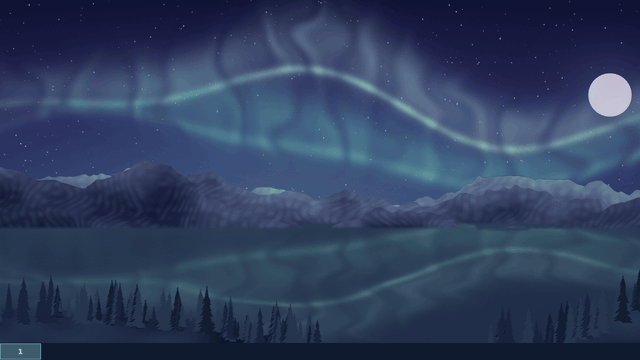
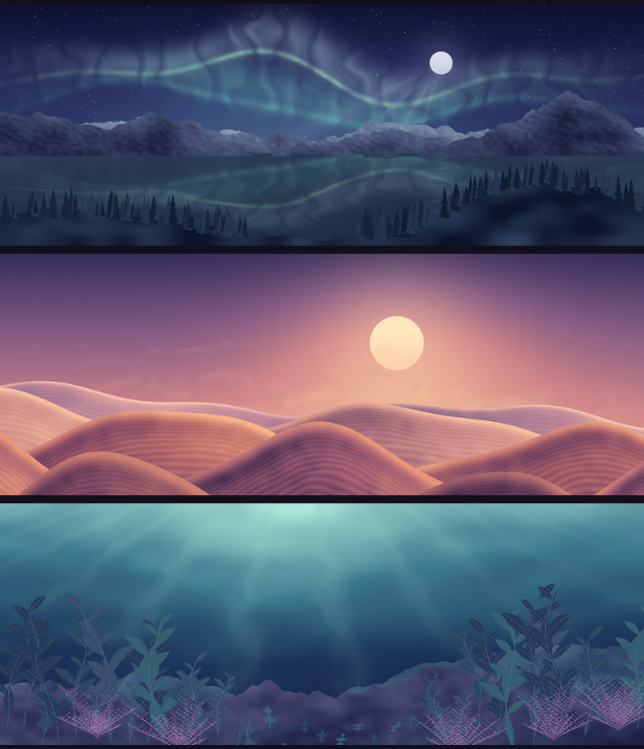

# Wallpaper-MY

Процедурные живые обои, вдохновлённые планшетами с Android 3.0 и палитрами Material You. Свет, отражения и частицы меняются внутри сцены. В i3 глубина также ощущается при переключении рабочих столов. Из плоского кадра `m3` может взять цвета для темы рабочего стола.



## Коллекция

- **Aurora Fjord** — сияние отражается в озере, лунные лучи рассеиваются в дымке, на воде видны отдельные блики.
- **Amber Dunes** — над песчаными грядами два потока дымки свиваются и рассеиваются.
- **Tidal Garden** — листья и коралловые веера сгибаются под течением с детализацией исходных слоёв. Лучи подсвечивают листья и взвесь в воде.



[Отдельный GIF Tidal Garden](docs/tidal.gif) · [Водоросли в масштабе 1:1](docs/tidal-detail.png) · [Замысел и фотореференсы](docs/design.md#свет-и-течение)

## Запуск на i3/X11

```sh
gallery=$(nix build github:Kostr2007/Wallpaper-MY/v0.4.0#gallery --no-link --print-out-paths)
nix run github:Kostr2007/Wallpaper-Parallax-i3/v0.5.0 -- \
  --image "$gallery/aurora-fjord/aurora-fjord.png" --motion spring --travel 36
```

## Генерация своих вариантов

```sh
nix run github:Kostr2007/Wallpaper-MY/v0.4.0 -- \
  --preset tidal-garden --seed 27 --accent '#7baacb' \
  --width 3840 --height 1440 --output ./wallpapers
```

`--list` выводит имена сцен. Без `--preset` команда создаст всю коллекцию. Разрешение задаёт размер холста. Для прокрутки на мониторе 2560×1440 удобно взять холст шириной около 4000 пикселей. `--seed` меняет детали, а `--accent` смещает оттенки сцены. Одинаковые настройки и версия генератора дают одинаковый результат. Для повторной генерации укажите другой каталог.

Команда сохраняет `tidal-garden/tidal-garden.png` и соседнюю папку `tidal-garden.parallax/`. PNG можно использовать как обычные обои. Папка содержит слои и `motion.json`, которые читает [Wallpaper-Parallax-i3](https://github.com/Kostr2007/Wallpaper-Parallax-i3/tree/v0.5.0#живые-сцены). Переносите PNG вместе с этой папкой.

## Свои анимации

Сохраните рецепт пресета, поменяйте параметры и соберите GIF для просмотра.

```sh
nix run github:Kostr2007/Wallpaper-MY/v0.4.0 -- \
  --write-recipe aurora-fjord > aurora.json
nix run github:Kostr2007/Wallpaper-MY/v0.4.0 -- \
  --recipe aurora.json --width 1280 --height 480 --output ./work \
  --gif ./preview.gif
```

У каждого плана свой стек эффектов. Сила и масштаб поддерживают ключевые кадры с плавной, линейной и ступенчатой интерполяцией. `--list-effects` показывает доступные эффекты, `--still` сохраняет слои первого кадра для обычного параллакса. [Руководство по рецептам и приёмам из Kdenlive](docs/effects.md)

## Nix и Material You

Flake использует два входа.

```nix
wallpaper-my = {
  url = "github:Kostr2007/Wallpaper-MY/v0.4.0";
  inputs.nixpkgs.follows = "nixpkgs";
};
wallpaper-parallax = {
  url = "github:Kostr2007/Wallpaper-Parallax-i3/v0.5.0";
  inputs.nixpkgs.follows = "nixpkgs";
};
```

Этот модуль Home Manager получает `inputs` через `extraSpecialArgs`.

```nix
{ inputs, pkgs, ... }:
let
  gallery = inputs.wallpaper-my.lib.mkGallery {
    inherit pkgs;
    width = 3968;
    height = 1440;
  };
in {
  imports = [ inputs.wallpaper-parallax.homeManagerModules.default ];
  xdg.dataFile."wallpapers/wallpaper-my".source = gallery;
  services.wallpaper-parallax = {
    enable = true;
    image = "${gallery}/aurora-fjord/aurora-fjord.png";
    motion = "spring";
    travel = 36;
  };
}
```

Если `m3` управляет выбором обоев, добавьте `${config.xdg.dataHome}/wallpapers/wallpaper-my` в `M3_WALLPAPER_DIRS` и передайте службе `stateFile` вместо `image`. Файл состояния указывает на выбранный плоский кадр и может передать `ambient: false`, когда пользователь выключил движение внутри сцены. При смене обоев `m3` извлекает палитру из PNG через `matugen`.

## Исследование и проверка

[Заметки об Android, Material You и процедурных генераторах](docs/design.md). `nix flake check` проверяет команду генерации, повторяемость, портретный формат, ключевые кадры, GIF и композицию экспортированных слоёв. Оба GIF записаны с i3 на Xvfb командой `tools/record-demo.sh` из Wallpaper-Parallax-i3 с флагом `--live`.
